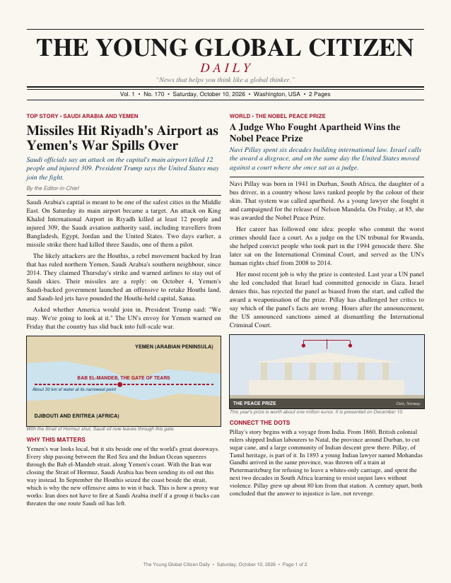
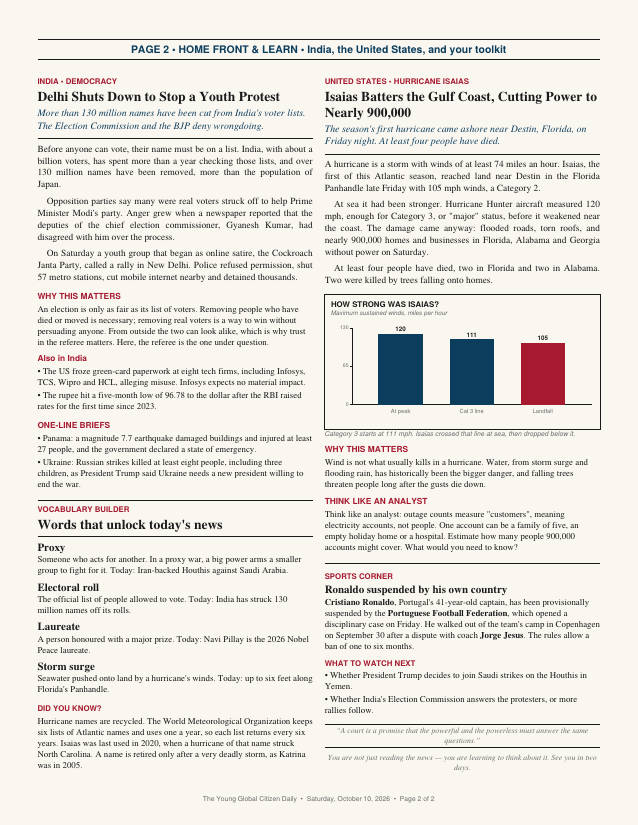
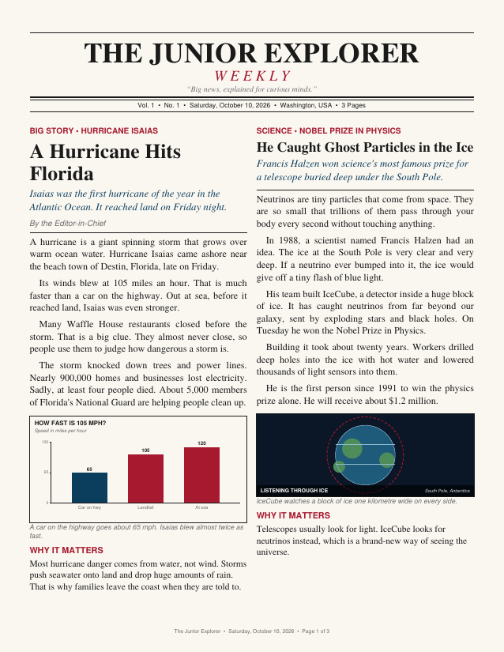
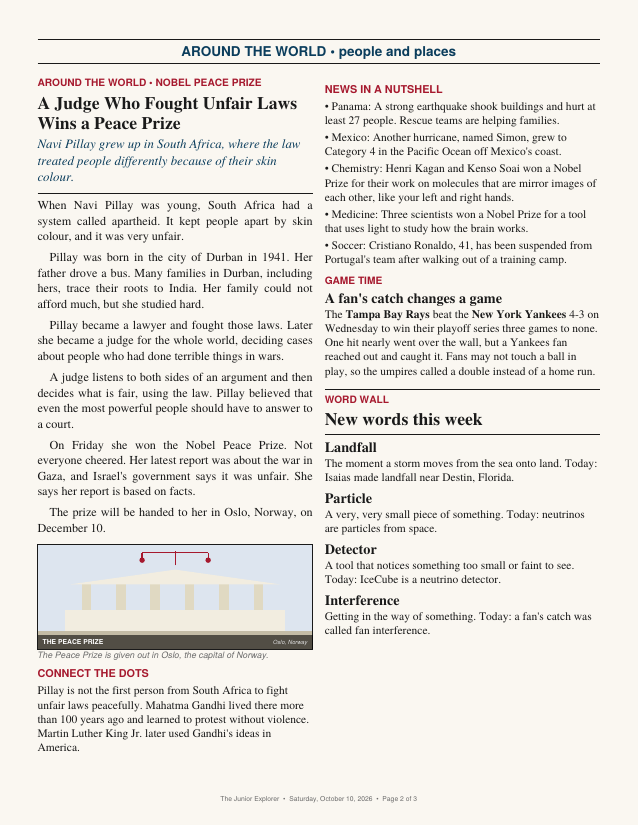
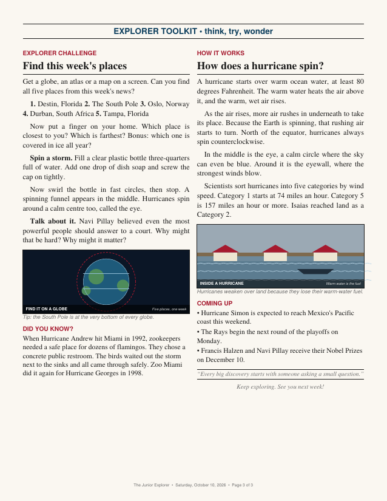

# News Pebbles: Print-Ready Daily Newspapers for Kids & Teens

[](https://newspebbles.com)
[](https://www.python.org/)
[](LICENSE)

**News Pebbles** (teen newspaper builder) is an open-source engine for automatically publishing calm, age-appropriate current events newspapers for children, teens, and young readers (ages 6 to 18). Built with Python and ReportLab for families, homeschool education, and classroom discussions.

## Examples and Output Screenshots

| *The Young Global Citizen Daily* — age 13, 2 pages, every 2 days | *The Junior Explorer* — age 9, 3 pages, weekly |
|---|---|
|   |    |

Same engine, same news week, two different editions. The only difference
between them is their `edition.yaml`.

## Quick start

```bash
git clone https://github.com/devendr-ai/teen-newspaper-builder.git && cd teen-newspaper-builder
python3 -m venv .venv && source .venv/bin/activate   # Windows: py -m venv .venv, then .venv\Scripts\activate
pip install -r requirements.txt                      # optional: poppler, for page images
python -m ygc editions
python -m ygc check editions/junior-explorer/issues/2026/2026-10-10.json --archive
```

The PDF and page images land in `build/`. **New here? Follow
[docs/GETTING_STARTED.md](docs/GETTING_STARTED.md)**: twelve tested steps from
cloning to a printed paper of your own design.

## Make your own paper

The easy way: the **Design your own** page (`tools/newspaper-builder.html`,
published as `builder.html`). Pick the reader, the kind of paper, interests,
sections and length; it shows a proof of every page, writes instructions for
your own chatbot and prints its reply ([docs/DESIGN_YOUR_OWN.md](docs/DESIGN_YOUR_OWN.md)).
Under "For developers" it also gives the edition file. Everything it produces is
tested against the engine.

The hands-on way:

```bash
python -m ygc create-edition my-paper --from young-global-citizen
#   edit editions/my-paper/edition.yaml: reader, purpose, desks, pages
python -m ygc prompt my-paper              # AI instructions, generated from your YAML
python -m ygc new my-paper                 # today's empty issue, numbered and dated
python -m ygc check editions/my-paper/issues/<year>/<date>.json
```

[docs/CUSTOMIZING.md](docs/CUSTOMIZING.md) covers every setting: age and
reading level, purpose, countries and topics, sections, pages and columns,
cadence and labels.

## How it works

- **Edition** (`editions/<id>/edition.yaml`): who the paper is for and what it
  contains. Desks set coverage; blocks set sections; the page plan places them.
- **Issue** (`editions/<id>/issues/<year>/<date>.json`): one issue's content,
  keyed by block. Every story carries its source URLs.
- **`python -m ygc check`**: validates the issue against its edition, measures
  every column's exact fit, builds the PDF and renders page images. `PASS`
  plus a look at the pages means it's ready to print.
- **`PROMPT.md`**: each edition's AI editor instructions, generated from its
  YAML and the shared [craft rules](docs/CRAFT_RULES.md). Paste it into any AI
  tool that can search the web.

The full routine is in [docs/WORKFLOW.md](docs/WORKFLOW.md); the internals are
in [docs/ARCHITECTURE.md](docs/ARCHITECTURE.md).

## Principles

- **Configure, don't code.** A new paper is a new YAML file.
- **Fix the content, never the layout.** Overflow is reported per column, in
  points and lines, before anything is printed.
- **Every figure is traceable.** Stories list their sources; they're never
  printed, but anyone can verify a number in thirty seconds.
- **Rules carry their reasons.** Every craft rule records the failure that
  created it.

`python -m pytest -q` must pass before pushing; CI runs it on every push.

## License & Community

- **License:** Content and layouts are licensed under [Creative Commons Attribution-NonCommercial 4.0 (CC BY-NC 4.0)](LICENSE).
- **Contributing:** See [CONTRIBUTING.md](CONTRIBUTING.md) and [CODE_OF_CONDUCT.md](CODE_OF_CONDUCT.md).
- **Security:** See [SECURITY.md](SECURITY.md).
- **Corrections & Feedback:** Email `corrections@newspebbles.com` or `info@newspebbles.com`.
